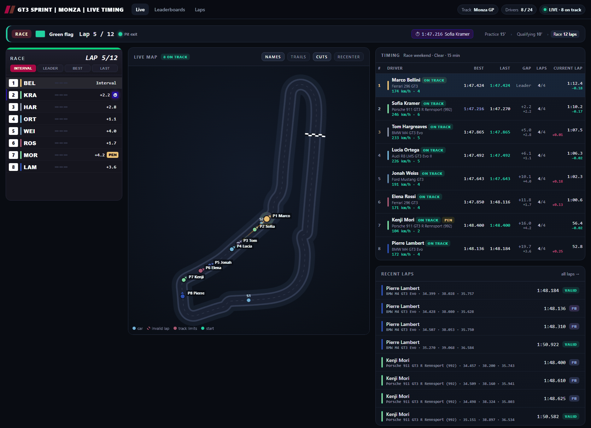
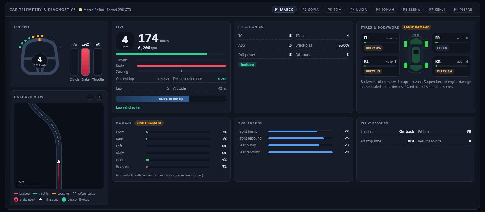
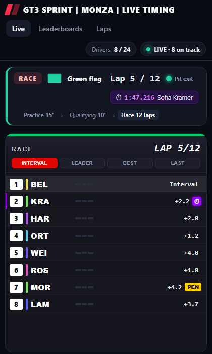
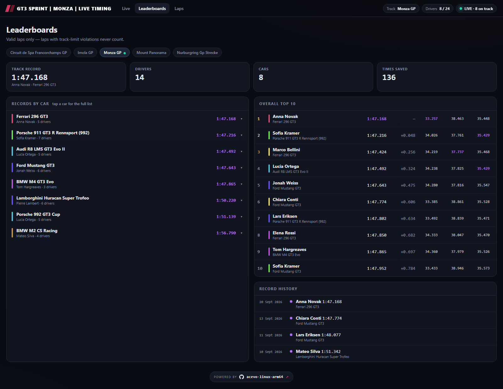

# acevo-linux-arm64

A self-hosted **Assetto Corsa EVO dedicated server** for **ARM64 Linux** (Box64 + Wine in Docker), with a
**real-time live timing website** and a **Discord bot**.

The live timing does not depend on the game's log alone: a passive network observer (`lapwatch`) decodes the
game protocol, so the site knows whether every lap is really valid, where each car is on track, and what the car
is doing (gear, rpm, pedals, tyres, damage, electronics).

| | |
|---|---|
| **Game server** | The Windows x86_64 dedicated server running on ARM64 through Box64 + Wine, downloaded from Steam with DepotDownloader |
| **lapwatch** | Passive observer of the game traffic: lap validity, splits, cuts, positions, telemetry, diagnostics |
| **Dashboard** | Live timing website (Python standard library only, WebSocket push) |
| **Discord bot** | Slash commands, pinned live board, record announcements, server administration |



<table>
  <tr>
    <td width="70%"></td>
    <td width="30%"></td>
  </tr>
  <tr>
    <td colspan="2"></td>
  </tr>
</table>

<sub>Screenshots of a simulated race with fictional drivers.</sub>

## Features

**Live page**
- Canvas track map that draws itself from the first valid lap, with cars interpolated at 60 fps, trails, cut markers, zoom and pan.
- Timing tower: best and last lap, sectors (purple/green), gap, valid laps, running lap clock and live delta to the reference lap.
- Car telemetry for the selected car: gear, speed, rpm bar, throttle, brake and steering.
- Cockpit: a steering wheel that turns with the driver's input, shift lights, pedals, and a zoomed heading-up
  onboard map showing the driven line coloured by braking/throttle/coasting, with brake points, minimum corner
  speed and throttle pick-up marked against the reference lap.
- Car diagnostics: electronics (TC, ABS, brake bias, engine map…), tyre wear, dirt and wetness per wheel, bodywork damage per zone, damper settings, pit state and pit plan.
- Elevation profile of the lap, activity feed, race control messages (penalties, investigations, flags), track records.
- Yellow flags: a car stopped or much slower than the reference lap at that point of the track is flagged on the
  map, in the tower and in the session bar.
- The site takes the game server's name as its title and follows it when the bot renames the server.

**Race weekends**
- Session bar with the current session (practice, qualifying, race), animated flags (green, white, chequered),
  start lights, formation lap, pit-exit light, countdown or `Lap 3 / 8`, and the weekend schedule.
- F1-style timing tower: position boxes, driver codes, interval or gap to the leader, live mini-sectors, gained and
  lost places, fastest-lap highlight and animated banners (fastest lap, lights out, pit stop, penalty, chequered flag).
- Official race order from the server, gaps measured at the timing lines, penalties and investigations, pit stops,
  race-control messages, DNF/DSQ.

**Leaderboards and laps**
- Per-track and per-car leaderboards with sectors and record history.
- Every lap with the validity decided by the game server; invalid laps never reach a leaderboard.
- Driver pages with consistency, clean-lap rate and personal records.

**Discord bot**
- Pinned live board edited in place, track-record announcements (pinned), car records, invalid-lap notices, podium at the end of a race.
- Admin commands to change track, weather, duration, mode, password, server name, restart/stop/start and update the game from Steam.
- Class and pack challenges: GT3, GT2 and GT4 built from the server's own car list, plus themed packs (Cup, F1, JDM,
  Homologation, Hot Hatch, Supercars…) grouped by performance index. Only those cars are allowed and the record
  holder (or the last race winner) goes into the server name, optionally with a time to beat until a real lap is
  faster.
- Race weekends from Discord (practice, qualifying, race in laps or minutes, mandatory pit stop rules), session
  cycling, Steam updates with Steam Guard guidance, penalty and race-control announcements, and a safety check that
  never restarts the server under connected drivers without `force`. Full list in [docs/DISCORD.md](docs/DISCORD.md).

**Operations**
- Every threshold, path, label and colour is configurable through environment variables ([docs/CONFIGURATION.md](docs/CONFIGURATION.md)).
- Moderation without restarts: blocked drivers and single removed laps (tombstones).
- No personal data is published: SteamIDs and IP addresses never leave the backend.

## Requirements

- An **ARM64 Linux** host with Docker Engine and **Docker Compose v2.24+**.
- A **Box64** binary built for your CPU, placed in the repository root as `box64` ([ptitSeb/box64](https://github.com/ptitSeb/box64)).
- The x86_64 `libstdc++.so.6` and `libgcc_s.so.1` in `x86_64-libs/` (copy them from any x86_64 Linux distribution).
- A Steam account that owns the Assetto Corsa EVO dedicated server tool.
- Optional: a Discord application with a bot token.

## Quick start

```bash
git clone https://github.com/RiccardoSilvestri/acevo-linux-arm64.git && cd acevo-linux-arm64

cp .env.example .env
cp config/game.env.example config/game.env            # Steam credentials and game settings
cp config/dashboard.env.example config/dashboard.env  # optional: site name, colours, units
cp config/bot.env.example config/bot.env              # optional: Discord bot

mkdir -p dashboard-data server-data
sudo chown -R "$(id -u):$(id -g)" dashboard-data      # must match APP_UID/APP_GID in .env

docker compose up -d --build
docker compose logs -f ace-server
```

On the first start the game server downloads the game files from Steam. If Steam asks for a Steam Guard code,
run `docker attach acevo-server`, type the code and detach with `Ctrl-P` `Ctrl-Q`.

`server_config.json` and `season_def.json` are created in `server-data/server/` from the templates in `config/`
on the first start, using the values of `config/game.env`. After that, edit them there or use the Discord bot.

Open `http://<host>:8090`, or serve it on your domain over HTTPS with the optional proxy (`COMPOSE_PROFILES=https`, see [docs/CONFIGURATION.md](docs/CONFIGURATION.md#https)). Ports: `9600` TCP/UDP for the game, `8090` TCP for the website. The game's HTTP API
(`8000`) stays on the internal Docker network.

## Security

- The Discord bot mounts the **Docker socket** to restart the game server. Access to that socket is equivalent to
  root on the host: keep the bot token secret and set `DISCORD_ADMIN_IDS` in `config/bot.env` so that only the
  listed Discord users can run admin commands.
- Keep `.env` and `config/*.env` private: they hold the Steam credentials and the bot token. They are ignored by git.
- Only the website port and the game port need to be reachable from the internet. The game's HTTP API (`8000`)
  stays on the internal Docker network.
- The website never publishes SteamIDs or IP addresses, and it checks the `Origin` of WebSocket connections
  (`CHECK_ORIGIN`).

## Try the website without a game server

The repository ships an anonymised capture of a short session. Replay it into a local dashboard:

```bash
sh tests/e2e/demo.sh            # then open http://127.0.0.1:8099
```

## Tests

```bash
python3 tests/test_lapwatch.py  # protocol decoding, lap validity, traces, telemetry (offline)
sh tests/e2e/run_e2e.sh         # lapwatch + dashboard + WebSocket + REST + security checks
```

`tools/boot_all_tracks.py --yes` starts the real server once on every track and checks that the dashboard follows
(it disconnects drivers and takes about 30 minutes).

## Repository layout

```
├── docker-compose.yml        the four services
├── Dockerfile                game server image (Box64 + Wine + DepotDownloader)
├── box64.box64rc             Box64 settings for the server executable
├── scripts/                  entrypoint, Steam download, server start
├── config/                   templates and per-service environment files
├── lapwatch/                 network observer (lapwatch.py, schema.json)
├── dashboard/                website backend (app.py) and static pages
├── bot/                      Discord bot
├── tests/                    offline and end-to-end tests, anonymised fixture
├── tools/                    pcap anonymiser, all-tracks boot check
└── docs/                     configuration, architecture, protocol notes, screenshots
```

## Documentation

- [docs/CONFIGURATION.md](docs/CONFIGURATION.md) — every variable, with defaults.
- [docs/ARCHITECTURE.md](docs/ARCHITECTURE.md) — how the pieces fit together and why.
- [docs/PROTOCOL.md](docs/PROTOCOL.md) — what is known about the game's network protocol.
- [docs/DISCORD.md](docs/DISCORD.md) — bot commands, announcements, classes and packs.

## Disclaimer

This is an unofficial community project, not affiliated with or endorsed by the developers or publishers of
Assetto Corsa EVO. All trademarks belong to their owners.

No game code, binaries or assets are included: the server files are downloaded from Steam with your own account.
The live timing works passively, by observing the network traffic of your own server, for interoperability. You
need your own licence of the dedicated server.

## License

[MIT](LICENSE)
